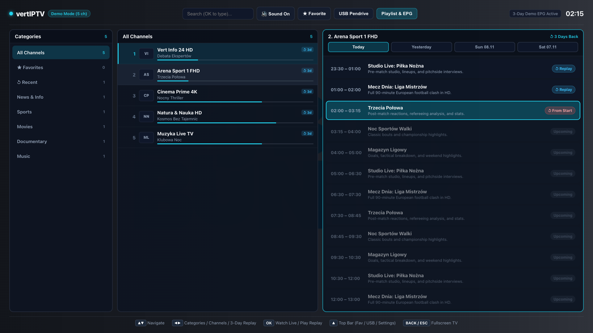
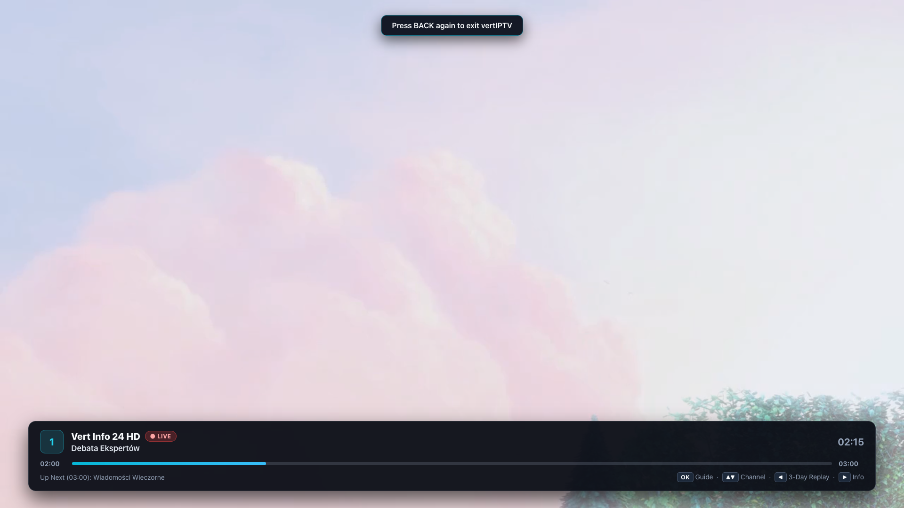
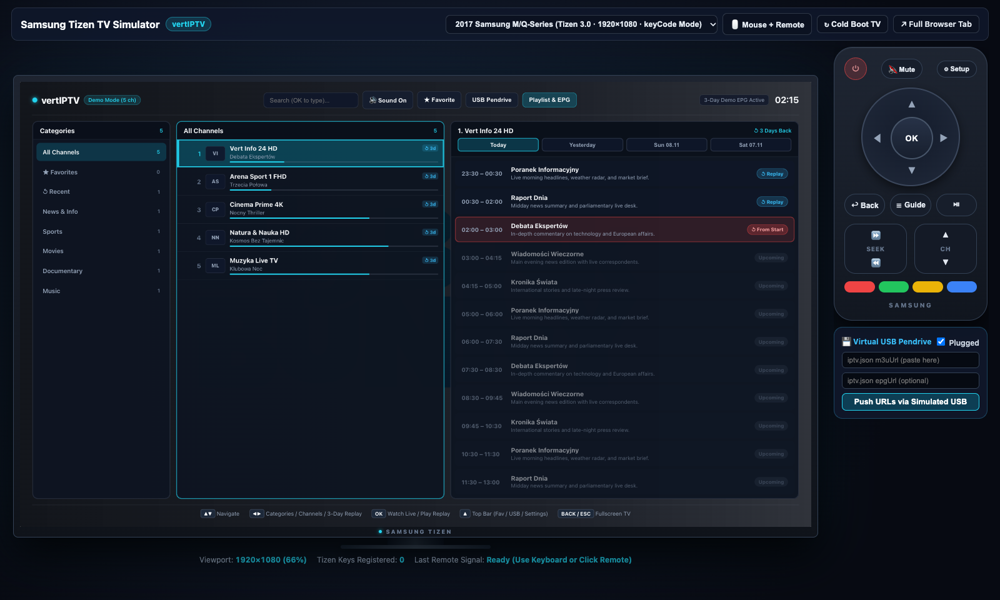
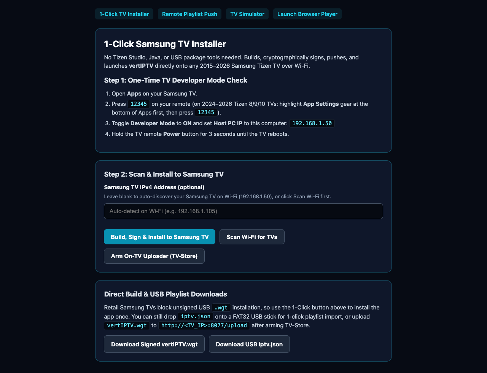

# vertIPTV — Fast Samsung Tizen IPTV & 3-Day Catchup Player

<p align="center">
  
</p>

<p align="center">
  Performance-first <strong>M3U + XMLTV EPG</strong> player built specifically for <strong>Samsung Tizen Smart TVs (2015–2026 / Tizen 2.3–10.0)</strong>, engineered around instant channel zapping and effortless <strong>3-day catchup (archive / timeshift)</strong> playback.
</p>

<p align="center">
  <a href="https://github.com/verte21/vert-iptv/releases/latest"><strong>⬇️ Download Latest Pre-Signed <code>vertIPTV.wgt</code> &amp; Portable Installer Kit</strong></a>
</p>

---

## Screenshots

### 3-Column TV Guide & Instant 3-Day Catchup (`Today` / `Yesterday` / `-2d` / `-3d`)


### Fullscreen Hardware Playback & Live EPG Info Bar


### Built-In Samsung Tizen TV Simulator & Virtual Remote


### Zero-Tizen-Studio 1-Click TV Installer Dashboard


---

## Highlights

- **Off-Main-Thread Parsing:** Parses 20,000+ channel M3U playlists and multi-megabyte XMLTV (`.xml` & `.xml.gz`) EPG feeds without freezing low-power TV ARM CPUs.
- **Virtualized 60 FPS Channel List:** Fixed-pool virtual viewport renders ~18 DOM rows regardless of playlist size, using pure ES5 + Flexbox (`-webkit-flex`) for full backward compatibility down to 2015–2020 Samsung TVs (`J`, `K`, `M`, `N`, `R`, `TU` series) as well as 2021–2026 sets.
- **Crash-Proof Playlist Persistence:** Triple-redundant storage (`tizen.filesystem` `wgt-private` + `IndexedDB` + `localStorage`) keeps your playlist and EPG cached across TV power cuts and Smart Hub WebView resets, opening in `<100ms`.
- **Universal 3-Day Rewind:**
  - Press **`▶ Right`** on any channel in the guide (or **`◀ Left`** while watching Live TV fullscreen) to browse **Today / Yesterday / 2 Days Ago / 3 Days Ago**.
  - Auto-detects **Xtream Codes** (`/timeshift/...` & `timeshift.php`), **Flussonic** (`index-UTC-DUR.m3u8`), **Shift** (`?utc=&lutc=`), and custom `catchup-source` templates (`{utc}`, `${start}`, `{duration}`, `{duration:60}`, etc.).
  - Generates automatic **1-hour archive slots** even when a channel lacks XMLTV guide data.
- **Triple Playback Engine:** Native Samsung hardware **`webapis.avplay`** (raw MPEG-TS `.ts` + HLS `.m3u8` + HEVC/AC3 hardware decoding) with self-hosted **`mpegts.js`** and **`hls.js`** fallbacks for desktop/browser preview.
- **Zero-Remote-Typing Playlist Setup:** Import `iptv.json` (or `playlist.m3u` + `epg.xml`) in 1 click from a **FAT32 USB pendrive**, or push URLs over Wi-Fi from your phone.

---

## Install on Any Samsung Smart TV (No Tizen Studio Needed!)

> **Why USB alone doesn't install `.wgt` apps on retail Samsung TVs:**  
> Consumer Samsung Tizen OS blocks installing `.wgt` files directly from a USB stick. Instead, you push `vertIPTV.wgt` over Wi-Fi **once** (~60 seconds) from **your phone** or **any PC**. Once installed, `vertIPTV` lives permanently inside the TV's internal memory — **no phone, PC, or server is needed afterward.**

### Step 1 — Enable Developer Mode on the Samsung TV (1-Time, 30 Seconds)

1. Turn on your Samsung TV, press **Home**, and open **Apps**.
2. Enter **`12345`** on the remote:
   - **2015–2023 TVs (e.g. `J`, `K`, `M`, `N`, `R`, `TU`, `AU`, `BU`, `CU` series):** Press `12345` directly inside **Apps** *(on slim remotes without number keys, press the `123` button first)*.
   - **2024–2026 TVs (Tizen 8–10):** Highlight **App Settings** (gear icon at the bottom of **Apps**) first, then press `12345`.
3. Switch **Developer Mode** to **ON**.
4. In **Host PC IP**, enter the Wi-Fi IP address of the **phone or PC** you are about to push the file from *(this is only a 10-second permission to accept the `.wgt` transfer; the TV never needs that IP again once installed)*.
5. **Cold-reboot the TV:** Hold the remote **Power** button down for ~3 seconds until the Samsung Tizen boot logo appears.

---

### Step 2 — Pick Whichever Device You Have Handy

#### Option A: Install Straight from Your Phone (Android / iPhone — Zero PC Required)
1. Download **`vertIPTV.wgt`** from [**GitHub Releases**](https://github.com/verte21/vert-iptv/releases/latest) onto your phone.
2. Install [**Apps2Samsung**](https://github.com/Apps2Samsung/Apps2Samsung/releases/latest) on your phone (`-android.apk` on Android, or via SideStore on iPhone) and connect to the TV's Wi-Fi.
3. Open **Apps2Samsung** — it displays your phone's current Wi-Fi IP at the top (use that IP in Step 1 above).
4. Select your TV $\rightarrow$ choose **Custom `.wgt` file** $\rightarrow$ pick `vertIPTV.wgt` $\rightarrow$ tap **Install**.

#### Option B: Double-Click Portable USB Kit on Windows (or Linux / macOS)
1. Download **`vertIPTV-usb-kit.zip`** from [**GitHub Releases**](https://github.com/verte21/vert-iptv/releases/latest) and extract it to a folder or **FAT32** USB stick (no Node.js, Java, or Tizen Studio needed).
2. Double-click **`INSTALL-FROM-WINDOWS.bat`** (Windows 10/11) or **`INSTALL-FROM-MAC.command`**.
3. The window prints that PC's current Wi-Fi IP, finds your Samsung TV automatically, signs & installs `vertIPTV.wgt`, and launches the app on your TV.
4. *(Optional)* Edit **`iptv.json`** on the same FAT32 USB stick with your `m3uUrl` and `epgUrl`, plug the stick into your Samsung TV, and click **USB Pendrive** inside `vertIPTV` for instant 1-click playlist import!

#### Option C: From Source (CLI or 1-Click Web Dashboard — Windows / Linux / macOS)
```bash
git clone https://github.com/verte21/vert-iptv.git
cd vert-iptv

# 1-command Wi-Fi auto-discover, build, sign, install & launch:
npm run tv:install

# Or launch the local Web Player + Simulator + 1-Click Browser Installer:
npm start
# • 1-Click TV Installer: http://localhost:8787/install
# • Samsung TV Simulator: http://localhost:8787/simulator
# • Phone Playlist Push:  http://<YOUR_LAN_IP>:8787/remote
```

#### Option D: Upload Future Builds Directly to the TV (`TV-Store` On-Device Installer)
Run `npm run tv:arm-store` once to install and arm [**Apps2Samsung TV-Store**](https://github.com/Apps2Samsung/TV-Store) on your TV, then set the TV's `Host PC IP` to `127.0.0.1`. From then on, upload any `.wgt` straight to **`http://<TV_IP>:8077/upload`** from any phone/browser and press **`OK` ("Install on this TV")** on your Samsung remote.

*(Already running **TizenBrew**? `package.json` includes `"packageType": "app"` metadata so `vertIPTV` also loads directly as a TizenBrew module.)*

---

## Loading Your Playlist (`iptv.json` via USB or Remote Push)

Create **`iptv.json`** in the root of any **FAT32** USB stick (already templated inside `vertIPTV-usb-kit.zip`) and plug it into your TV:

```json
{
  "m3uUrl": "http://YOUR-PROVIDER-URL/get.php?username=USER&password=PASS&type=m3u_plus&output=ts",
  "epgUrl": "http://YOUR-PROVIDER-URL/xmltv.php?username=USER&password=PASS",
  "catchupMode": "auto",
  "catchupDays": 3
}
```

Or drop raw `playlist.m3u` + `epg.xml` files onto the USB stick root — `vertIPTV` detects both automatically.

---

## Samsung TV Remote Controls

| Remote Button | Fullscreen TV Mode | Channel Guide & 3-Day Catchup |
| :--- | :--- | :--- |
| **`OK` / `Enter`** | Open Channel Guide *(Pause/Play in Archive)* | Watch Live Channel / Start Catchup Program |
| **`▲` / `▼`** | Previous / Next Channel | Navigate Categories, Channels, or Programs |
| **`◀ Left`** | **Instant 3-Day Replay** *(or `-30s` in Archive)* | Previous Column / Previous Day |
| **`▶ Right`** | Show Live Info Bar *(or `+30s` in Archive)* | Open **3-Day Catchup** Column / Next Day |
| **`CH+` / `CH-`** | Zap Channel | Page Jump (10 items) |
| **`0` – `9`** | Direct Channel Number (`0` = Return to Live) | Direct Channel Number Jump |
| **`Red` / `F`** | Toggle Favorite Channel | Toggle Favorite Channel |
| **`Blue` / `S`** | Open Playlist & EPG Settings | Open Playlist & EPG Settings |
| **`Back` / `Return`** | Hide Info / Return to Live / Exit (`2×`) | Close Guide to Fullscreen TV |

---

## Development & Verification

```bash
npm run build   # Builds pre-signed dist/vertIPTV.wgt + dist/vertIPTV-usb-kit.zip
npm test        # Runs M3U/XMLTV benchmarks, catchup URL, persistence & package checks
```

## License

MIT
